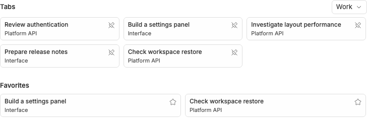

# Chat Tabs for BB

Chat Tabs adds VS Code-style pinned and preview chat tabs beneath BB's native
header. Switch chats, search recent conversations, or start a new chat in a
selected project directly from the strip. An optional **Tabs** list of pinned tabs also
appears on the **New chat** screen. The BB sidebar remains available.




The screenshots show real plugin components in running BB with browser-local demonstration data. See [screenshot provenance and the complete gallery](docs/screenshots/README.md).

## Documentation

This README and the plugin overview are the English publication guides. Additional [feature notes (Russian)](docs/README.md) cover screens, operations, settings, persistence, and failure states.

## Highlights

- **Independent workspaces.** Switch between Work, Home, Other, or your own sets. Each has its own pinned tabs, order, preview, and favorites. Selection belongs to the current window; matching workspaces synchronize across windows. Switching restores that window’s last active tab in the set, or its first tab; an empty set opens New chat. The previously viewed chat is never inserted into the new set.
- **15 interface languages.** Follow the BB page or browser language, or select
  a language explicitly. User-authored chat titles and project names stay unchanged.

- **Favorite chats.** Choose **Add to favorites** in a tab's context menu. Favorites appear in their own list on **New chat**, independently of pinned tabs, and remain saved when you close a tab or replace its preview. Use **Remove from favorites** in the same menu to remove one; archiving or deleting the chat also removes it.
- **VS Code-style preview tab.** One unpinned preview represents a chat you opened but
  have not pinned. Opening another unpinned chat replaces it; background work
  never opens a preview. Closing it stays closed across reloads and other windows
  until you explicitly open that chat again. Its italic title makes the temporary state clear.
- **Pinned chats with a manual order per workspace.** Double-click a preview tab to
  pin it. Drag pinned tabs between projects in one shared horizontal sequence;
  the preview always remains last and is never draggable. Double-click a pinned
  tab title to rename it inline.
- **Distinct input, activity, and unread signals.** When BB is waiting for a
  question to be answered or a permission to be approved, a compact **?**
  marker replaces the working dot. Its tooltip explains the pending input;
  chat lists and pinned cards show the full **Needs input** status. This also works for nested chats.
  Active workflows, background agents and commands, plan mode, goals, and
  runtime activity have their own working indicator. An idle main chat shows a
  subdued grey dot while its sidechat is working; the main chat's own work keeps
  the regular indicator. Calm chats have no dot.
- **Explore subthreads from a tab.** A branch button counts only working
  descendants; calm branches show the bare button. Hover or click it to see all
  available direct children; nested side menus reveal deeper descendants, where
  unread subthreads keep their dots. Select a title to open that subthread as the
  normal preview tab. Keyboard navigation and separate touch expansion arrows
  are supported; archived branches are excluded.
- **Create a chat from the strip.** A fixed plus outside the horizontal scroller opens BB's native composer with the prompt focused. Hover for 300 ms to see projects with tabs in the current workspace first, then other recently active projects, ordered by activity within each group. **More** reveals the next 15 on click or after another 300 ms of hover. Choosing a project preselects it in the composer.
- **Try tab appearance locally.** The General/Appearance settings tabs offer a six-color palette and a searchable project alias/color manager with autocomplete, editing, and confirmed removal from the appearance list only. Strip titles can show `[alias] Title`; a tab's context menu overrides its inherited project color or restores inheritance. Appearance is shared across workspaces, without renaming native projects/chats or changing pins.
- **Pinned and recent navigation menu.** Open it by click, a 300 ms mouse
  hover, or two quick Shift presses with no other key in between. Search chat titles and project names across
  available BB chats, including older chats outside the last 100 visits. A project
  name finds chats in that project; combine it with title words to narrow results,
  for example `Office login`. Enable **Include archived
  chats in search** to also find archived chats with struck-through titles and
  an Archived status. Deleted and hidden chats are always excluded. Select a fuzzy match
  with the arrow keys, and press Enter to open it. The menu lists **Pinned**
  chats and a plugin-owned **History** of up to 100 visits. The first eight
  history entries appear immediately; **More** loads the next page on click,
  tap, keyboard selection, or a 300 ms desktop hover. Both menus animate in
  and out and respect reduced-motion preferences.
- **Safe lifecycle handling.** Archive and delete events immediately remove a
  chat from tabs, pins, and the home list. A disabled history tombstone remains
  with an Archived or Deleted label. Unarchiving makes that history item
  clickable again but intentionally does not restore its old pin or preview.
- **Reopen closed tabs.** `Ctrl+Shift+T` / `⌘⇧T` restores the last explicitly closed tab in the current workspace, including from New chat. Repeated presses undo older closes in that window; up to 100 records survive reload in session storage. Original order/pin is retained; a restored preview is pinned if another preview is already open, so no chat is displaced. Archived/deleted and already reopened chats are skipped; failed writes remain retryable. Browser-reserved shortcuts can only work when the browser forwards the key event to BB.
- **Keyboard commands.** The BB palette (`Ctrl+Shift+P` / `⌘⇧P`) lists Chat Tabs commands, and Settings → Keyboard can rebind any of them. Defaults: `Ctrl+Alt+1…8` / `⌘⌥1…8` select a tab and `9` the last one; `Ctrl+Alt+P` / `⌘⌥P` pins or unpins; `Ctrl+Alt+S` / `⌘⌥S` toggles a favorite; `Ctrl+Alt+W` / `⌘⌥W` switches to the next workspace; `F2` renames. Letter shortcuts follow the physical key, so they also work in Russian and other layouts. Parent chat, subthread tree, tab list, copy link, close others, and move left/right are palette-only until you bind them. On Windows, `Ctrl+Alt` doubles as AltGr, so rebind any default that collides with a character you type.
- **Desktop and touch behavior.** Desktop supports drag and drop, horizontal
  mouse-wheel scrolling, a conditional top scrollbar, middle-click close,
  `Ctrl+Tab` / `Ctrl+Shift+Tab`, and `Ctrl+W` / `⌘W` in BB Desktop. Touch
  layouts keep a 44×44 target, native horizontal swipe, and explicit Close
  buttons instead of HTML drag and drop.
- **Native-feeling actions.** The tab context menu offers Copy link, Mark as
  unread, Pin/Unpin, Show in workspaces, Rename, and Archive. The workspace
  submenu lets you check multiple sets independently: adding pins the chat in
  that set, removing closes only that tab and preserves favorites. Neither action
  navigates or switches your current workspace. Links are absolute and retain a
  textarea fallback when the Clipboard API is unavailable.
- **Theme-aware presentation.** The stylesheet uses BB semantic theme tokens
  and `color-mix(in oklch)` rather than hard-coded UI colors. It follows light,
  dark, and custom BB themes.

## Workspaces

Workspaces are enabled by default. Turn **Enable workspaces** off in settings to
use one shared set: Work, or the first remaining set if Work was deleted. The
selector and membership submenu are hidden, but all sets, favorites and undo
records are retained. Re-enabling restores this window’s previous selection,
including after reload, without navigating or inserting the current chat into
another set.

Use the workspace selector in the **thread header** or on **New chat**. It remains
available when the tab strip is hidden. Desktop shows the selected workspace name;
compact/mobile shows its first complete Unicode character (including emoji or
combined characters). Very long desktop names are ellipsized to keep header actions
accessible; full names remain in the tooltip and dropdown. The chat-list button
stays in the tab strip, with its existing left/right setting. The theme-aware popover
uses initial badges, a checkmark for the selected set, keyboard navigation, and
44px touch rows instead of the browser’s native select list. Its last option,
**Manage workspaces…**, opens the dialog to create, rename, or delete sets without
an extra toolbar button or changing the current selection. Creating a set keeps the
current workspace and chat open, and leaves the management dialog open so its name
can be corrected or another set added. Deletion requires confirmation, removes only that set, and never archives
or deletes chats. At least one workspace must remain; the maximum is 20.
Names contain 1–80 Unicode characters after trimming and cannot duplicate an
existing name, including translated default labels. Default names follow the
current plugin language, not the language used when they were created. Renaming a
workspace makes its name custom, so it no longer changes with the interface language.
Custom names are never translated.

Work, Home, and Other are created initially. Existing tabs, manual order, preview,
favorites, and closed-chat protection move into Work exactly once; Home and Other
start empty. Shared history, search, language, and display settings remain global.
Archive/delete reconciliation covers inactive sets too. Unarchiving restores
history navigation, not old memberships.

Selection and the last active tab per set use `sessionStorage`, with a memory-only
fallback when unavailable. Switching opens the remembered tab if it still belongs
to the set, otherwise its first tab; empty sets open **New chat** without creating
a chat. Each window remembers independently. A delayed response cannot navigate
after another switch or an explicit route change.
Reload restores a valid ID; a missing/deleted ID falls back to the first remaining
set. Other windows retain their own selection. Undo cards, pending actions, and
errors from a previous workspace visit never carry over after switching. A small
window-local parked-route marker also prevents reload from inserting the chat left
open during a switch into an otherwise empty set; explicit navigation clears it.

## Settings

All settings are available in **Settings → Installed plugins → Chat Tabs** or
through `bb plugin config tabs set <key> <value>`. Hiding a surface preserves pins, preview, order, favorites, and visit history. Disabling workspaces temporarily changes which saved set is used without merging or deleting the other sets; see [settings and their consequences](docs/plugin-settings.md).

| Key                     | Default | Purpose                                                                                                                                                                                                                                                                          |
| ----------------------- | ------- | -------------------------------------------------------------------------------------------------------------------------------------------------------------------------------------------------------------------------------------------------------------------------------- |
| `language`              | `Auto`  | Follow the BB page/browser language, or choose one of 15 languages: Bahasa Indonesia, Deutsch, English, Español, Français, Italiano, Português (Brasil), Tiếng Việt, Türkçe, Русский, العربية, हिन्दी, 한국어, 中文（简体）, 日本語. Unsupported languages fall back to English. |
| `searchArchivedChats`   | `false` | Include archived chats in title search. Results remain disabled with a struck-through title and Archived status; deleted chats stay excluded.                                                                                                                                    |
| `enableWorkspaces`      | `true`  | Enable separate workspaces. Off uses Work (or the first remaining set); other sets and window preferences are retained.                                                                                                                                                          |
| `showPinnedTabsList`    | `true`  | Show the Tabs list below the composer on the New chat screen. It contains pinned tabs in their manual order.                                                                                                                                                                     |
| `showTabsOnDesktop`     | `true`  | Top tab strip in the desktop layout.                                                                                                                                                                                                                                             |
| `showTabsOnMobile`      | `true`  | Top tab strip in the compact/mobile layout (`≤767px` or a coarse pointer).                                                                                                                                                                                                       |
| `showTabListButton`     | `true`  | Icon button for the dropdown list next to the strip.                                                                                                                                                                                                                             |
| `showTabListPinned`     | `true`  | Pinned section in the dropdown list.                                                                                                                                                                                                                                             |
| `showTabListHistory`    | `true`  | History section in the dropdown list; hiding it does not stop recording visits.                                                                                                                                                                                                  |
| `showChatListAsTree`    | `true`  | Group nested chats under their parents in side-opening submenus. Disable for a flat list; search results stay flat.                                                                                                                                                              |
| `tabListButtonPosition` | `Left`  | Side for the icon button: `Left` or `Right`.                                                                                                                                                                                                                                     |

English is the source language for publication text and static settings descriptors. The in-plugin language selector lists Auto first, followed by all 15 language autonyms in a stable alphabetical order; switching the UI language does not reorder the list or change stored values.

The list button hides automatically when disabled or when the displayed pinned/history sections contain fewer than two entries. Disabled history tombstones count toward that threshold; button visibility does not guarantee two clickable results. The additional language packs are
machine-assisted first drafts; native-speaker review is recommended before a
public localization release. The settings panel follows the same language immediately,
including labels, help text, Auto, and position choices. Setting keys and stored
option values remain unchanged, so CLI commands stay compatible. The underlying
static descriptors remain English for the CLI and as a fallback if the localized
panel cannot mount.

## Design boundaries

Workspace sets live in a single versioned JSON envelope in plugin-owned SQLite,
created through `bb.storage.migrate`; shared history stays in `bb.storage.kv`.
This avoids KV's 256 KB-per-value limit for the full 20-workspace collection.
Legacy `tabs.state.v1` and `tabs.closedThreads.v1` remain untouched as migration
sources. Failed writes are retryable; damaged new storage is reported rather
than overwritten with legacy data. Reload the BB window after restoring a backup.

Every set operation explicitly addresses a workspace ID. Scoped realtime events
carry the ID and a monotonic snapshot revision; catalog events never propagate a
window's selection. Late RPCs and older notifications cannot replace a new visit's
state. Sets are not derived from the BB sidebar and never replace it.

The implementation uses the public `homepageSection` API, `experimental_threadHeaderAction` for the workspace selector, `experimental_appOverlay` for the strip, `settingsSection`, and declarative `bb.settings.define`. The settings section saves validated patches through the
plugin RPC and `experimental_set`. A narrowly scoped CSS rule hides the redundant
host-generated form only on the Chat Tabs detail page while the localized section
is mounted; the native form returns if the section unmounts. This compatibility
rule depends on the host detail layout and needs checking after BB upgrades. It does
not modify BB core, replace sidebar slots, call `threads.tabs.update`, manually relocate host DOM, or use content scripts. The header control is host-rendered through its registered slot, not DOM injection.

The tab strip's visual reservation, unlike the registered header action, is a deliberately scoped CSS hybrid:

- a single main chat pane reserves space for the tab strip;
- a regular right panel does not count as a split and is not overlapped;
- a true split pane, full-screen right panel, sidebar drawer, or mobile right
  panel drawer hides the overlay and its portal menu;
- desktop uses a synchronized top proxy scrollbar only when the strip actually
  overflows; touch layouts retain native horizontal swipe;
- CSS anchors follow the main chat pane and sidebar without DOM mutation.

If BB changes its internal layout, validate the visual integration manually.
The plugin state itself remains independent of that layout.

## Development

```bash
npm install
npm run check
npm run build
```

Checks run locally, without CI/CD. `npm run check` runs Prettier, ESLint,
TypeScript (including tests), and Vitest. Use `npm run format` to apply formatting.
The development lint tools require Node.js 20.19+, 22.13+, or 24+; Node.js 24 is
recommended. `components/ui/` retains its upstream formatting and is excluded
from ESLint/Prettier, not from TypeScript or the public-SDK boundary test.
Mandatory completion checks are documented in [AGENTS.md](AGENTS.md); BB loads
the reminder from `.bb/AGENTS.md`.

For a live development cycle in BB:

```bash
bb plugin dev
```

To install the local plugin after building it:

```bash
bb plugin install .
```

Chat Tabs requires BB `0.43+` and Plugin SDK `0.4.97+`.

See the [changelog](CHANGELOG.md) for version history.

## License

[MIT](LICENSE). You may use, copy, modify, distribute, and publish forks while
retaining the license text and copyright notice.
