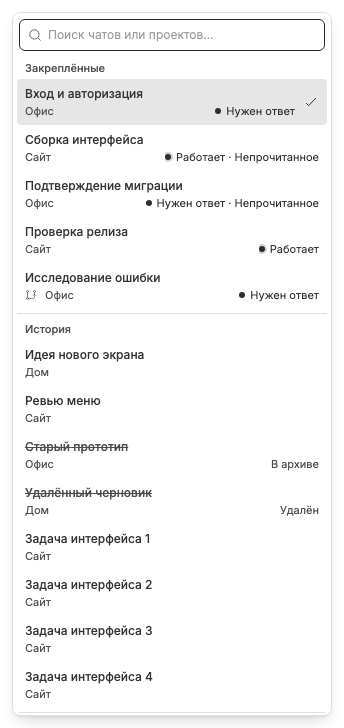

# Меню списка чатов

Кнопка списка в полосе открывает единое меню поиска, закреплений и истории. Оно доступно на desktop и mobile, но не рисуется, если `showTabListButton=false` или в показываемых закреплённой и исторической секциях суммарно меньше двух записей. Порог учитывает и disabled history tombstones; наличие кнопки не гарантирует два кликабельных результата. Preview не является закреплённым пунктом, но может появиться в истории.

Без запроса сначала видны закреплённые чаты выбранного [режима Chat Tabs](workspace-selector.md) в его ручном порядке, затем [общая история](chat-history.md) по свежести. При `enableWorkspaces=true` закрепления других режимов, отсутствующие в истории, добавляются в конец нижней секции. Один чат показывается один раз, даже если закреплён в нескольких режимах; закрепления текущего режима не дублируются ниже, пока их верхняя секция видна. Это только представление: чтение меню не записывает посещения и не меняет наборы. Preview и отдельное избранное неактивных режимов не добавляются. При выключенных режимах остаётся прежний список базового набора и истории. Нижняя секция начинается с восьми записей; «Ещё» добавляет восемь на клик/tap или после 300 мс наведения мыши. Между страницами остаётся разделитель. Кнопка раскрывает уже загруженную историю, а не увеличивает её лимит хранения.

По умолчанию `showChatListAsTree=true`: вложенные чаты вынесены в боковые подменю родителей. Известные загруженные родители добавляются как путь к дочернему чату, даже если сами не закреплены и отсутствуют в истории; дерево с закреплённым потомком относится к секции «Закреплённые» и не дублируется в истории. Если родитель неизвестен, чат остаётся доступен на верхнем уровне. Пагинация истории считает корни, а не вложенные пункты. Заголовок родителя открывает его чат, стрелка — подменю; клавиатурные ArrowRight/ArrowLeft раскрывают и закрывают уровни. Из поля поиска ArrowRight переводит фокус на выбранный корень. Выключение настройки возвращает плоский список. Поисковые результаты всегда плоские: совпавший вложенный чат можно открыть напрямую.

Название проекта и статус занимают вторую строку. Архивные и удалённые записи истории зачёркнуты и недоступны; их наличие не означает возможность открыть чат. Ввод запроса заменяет эти секции [поисковыми результатами](chat-search.md).

Меню открывается кликом, ArrowDown или двойным Shift; 300 мс mouse-hover не отбирают фокус у composer. Клик фиксирует hover-меню, повторный клик закрывает его. Настройки `showTabListPinned`, `showTabListHistory` и `tabListButtonPosition` меняют представление, не данные. Подробнее: [hover](hover-and-focus.md), [клавиатура](keyboard-shortcuts.md), [настройки](plugin-settings.md).
