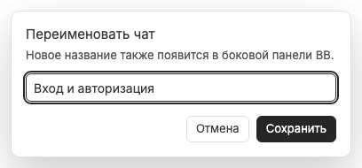

# Переименование чата: inline и диалог

Переименование вкладки меняет название самого чата BB через штатное действие sidebar, а не создаёт alias только для текущего режима. Успешное название сохраняется также в fallback-метаданных плагина, чтобы отсутствие чата в sidebar не вернуло старую подпись.

Двойной щелчок по названию закреплённой вкладки включает inline-редактор. Enter или blur сохраняют текст; Escape отменяет, включая последующий blur от браузера. Двойной щелчок по preview вместо этого [закрепляет её](preview-tab.md). Простое открытие чата остаётся первичным действием.

«Переименовать» в [контекстном меню](tab-context-menu.md) открывает диалог для любой вкладки. Допустимо 1–300 символов после trim. Пустое или слишком длинное название не отправляется; неизменённое закрывает диалог без лишней записи. Во время сохранения повторная отправка и закрытие отключены, ошибка оставляет текст и возможность повторить.

Оба редактора блокируют фоновые tab-shortcuts. Это не [переименование режима](workspace-renaming.md): там меняется только metadata набора, не sidebar или имена чатов. Подробнее об исключениях: [клавиатура](keyboard-shortcuts.md), [ошибки записи](synchronization-and-errors.md).
