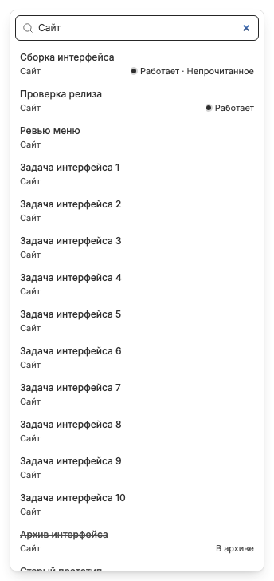

# Поиск по названию чата и проекту

Поиск в [меню списка](chat-list-menu.md) охватывает доступные чаты BB, а не только текущий режим, открытые вкладки или последние 100 посещений. Он использует метаданные названия и проекта; содержимое сообщений не читается.

Локальные метаданные дают первые результаты сразу. Через 250 мс вызывается `tabs_search`: сервер постранично читает метаданные чатов и имена проектов, кеширует набор на 30 секунд и возвращает до 30 совпадений. Устаревший ответ другого запроса или закрытого меню не применяется.

Сопоставление нечеткое, без учёта регистра и диакритики. Все слова должны совпасть хотя бы в названии или проекте; слово не склеивается из половин разных полей. Запрос `Офис вход` может совместить проект и название. Цифровой фрагмент версии тоже участвует в поиске.

Удалённые и скрытые чаты исключены. `searchArchivedChats=true` добавляет архивные результаты, но не разрешает открыть их из меню: они зачёркнуты и disabled. По умолчанию эта настройка выключена; на иллюстрации она включена для демонстрации.

ArrowUp/ArrowDown выбирают доступный результат, Enter открывает чат. Отсутствие совпадений отличается от ожидания серверного ответа. Связанные заметки: [пустые состояния](empty-loading-error-states.md), [архивация](archive-delete-lifecycle.md), [клавиатура](keyboard-shortcuts.md).
