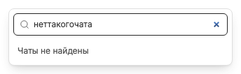

# Пустой список, загрузка и ошибка — разные состояния

На «Новом чате» пустые закрепления или избранное показывают подсказку действия, а не ошибку. Пустой режим остаётся управляемым через selector; отсутствие карточек не означает отсутствия каталога.

До первого успешного snapshot списки показывают «Загрузка вкладок…». Они загружаются без посещения чата, при видимой странице и готовом соединении. Начальная ошибка запускает повторы через 1, 2, 4, 8 и затем максимум 15 секунд; таймер прекращается после успеха, при скрытии, отключении секции или unmount. Foreground/reconnect запускают refresh.

Ошибка чтения/сохранения отображается отдельно. Повреждение нового хранилища не подменяется пустым state или старым legacy snapshot: требуется восстановить backup, затем перезагрузить окно. Удержанная карточка или галочка не должна показывать неподтверждённое сохранение.

В поиске отсутствие совпадений отличается от ожидания ответа. Membership-submenu имеет loading/error/Retry; управление режимами сохраняет поля и сообщение ошибки внутри окна. После успешной загрузки пустого state selector остаётся доступен, если режимы не выключены; кнопка списка отдельно требует минимум две записи показываемых закреплений и истории, включая disabled tombstones.

Связанные заметки: [Новый чат](new-chat-screen.md), [поиск](chat-search.md), [membership](workspace-memberships.md), [хранение](storage-and-migration.md), [ошибки](synchronization-and-errors.md).
