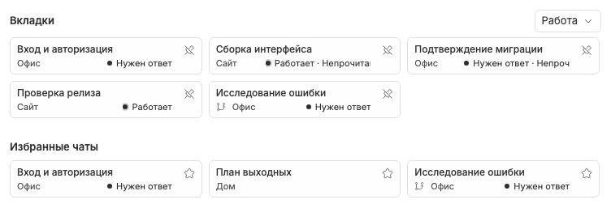

# Избранные чаты не зависят от открытых вкладок

Избранное — отдельный сохранённый список каждого режима, до 100 записей в порядке добавления. Его наличие не закрепляет чат и не означает, что у чата есть открытая вкладка. Поэтому галочка в membership-submenu не выводится из избранного.

«Добавить в избранное» и «Убрать из избранного» доступны в [контекстном меню](tab-context-menu.md). Закрытие, открепление и замена preview сохраняют эту запись. Архивирование или удаление чата, напротив, убирают его из избранного всех режимов.

На Новом чате секция «Избранные чаты» не зависит от `showPinnedTabsList`. Открытие карточки явно синхронизирует/reopens preview до штатной навигации; старый closed guard не делает избранное некликабельным.

Удаление с карточки сразу записывает изменение, но временно оставляет карточку с обратным действием. [Visit-local undo](homepage-card-undo.md) может восстановить даже избранное без вкладки, используя сохранённые metadata, без создания preview. Добавление сверх лимита отклоняется без вытеснения других favorites.

Связанные заметки: [закрытие](tab-closing.md), [Новый чат](new-chat-screen.md), [membership](workspace-memberships.md), [lifecycle](archive-delete-lifecycle.md).
