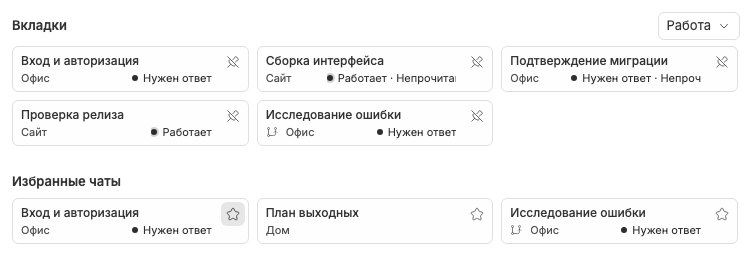

# Отмена действия на карточке текущего посещения

На Новом чате удаление из избранного или снятие pin сразу сохраняет состояние, но карточка остаётся на прежнем месте до окончания текущего посещения. Кнопка меняется на обратную: «Добавить в избранное» либо «Закрепить». Это временная возможность отмены, а не задержка записи до выхода со страницы.

Повторное нажатие восстанавливает отметку и исходную позицию карточки в текущем посещении, без открытия чата. Восстановление избранного использует retained metadata даже без вкладки; восстановление pin вызывает штатный путь открытия закреплённой записи.

После навигации, смены режима или нового посещения retained карточки пересобираются из сохранённого state. Удержание не хранится в SQLite/KV и не переносится между режимами/окнами. Архивирование или удаление чата сильнее этой локальной отмены: недоступную карточку удерживать нельзя.

Во время RPC блокируется только повторное действие этой карточки; её чат можно открыть. При ошибке отметка не меняется, показывается сообщение и доступна попытка снова. Это не [LIFO восстановления закрытых вкладок](closed-tab-restoration.md).

Связанные заметки: [Новый чат](new-chat-screen.md), [избранное](favorite-chats.md), [pins](pinned-tabs.md), [ошибки](synchronization-and-errors.md).
