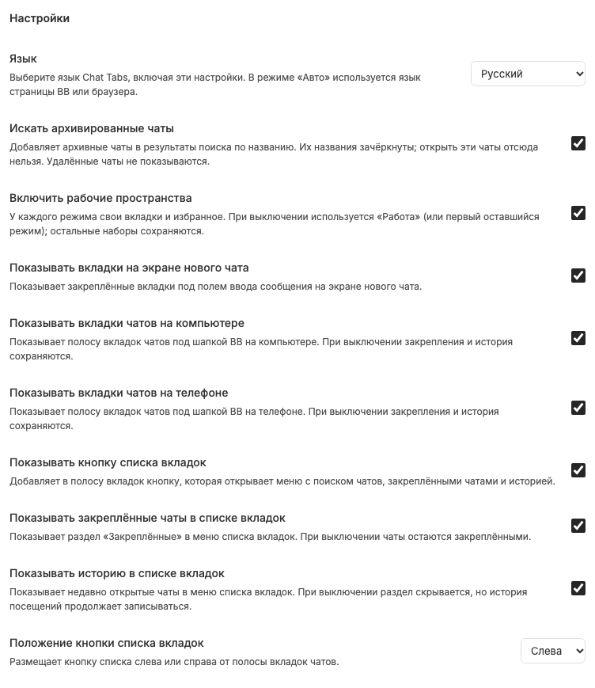

# Настройки Chat Tabs

Переводимая форма доступна на странице установленного плагина Chat Tabs в настройках BB. Настройки разделены на вкладки «Основные» и «Оформление». Основные переключатели сохраняются сразу, без отдельного Apply. В оформлении палитра и проект сохраняются отдельными кнопками. Переключение вкладок не записывает настройки и сохраняет несохранённые изменения палитры, алиаса и поискового запроса; стрелки и Home/End переключают вкладки с клавиатуры. Ключи и значения CLI остаются английскими, даже когда labels переведены: `bb plugin config tabs set <key> <value>`.

## Значения и последствия

- `language=Auto`: язык страницы BB, затем браузера, затем английский; либо один из 15 языков явно. [Локализация](interface-language.md) не переводит пользовательские имена.
- `searchArchivedChats=false`: архивные результаты не включены в [поиск](chat-search.md); включение добавляет их как disabled, не unarchive.
- `enableWorkspaces=true`: независимые наборы; выключение временно использует «Работу» или первый оставшийся, [не удаляя режимы](workspaces-disabled.md).
- `showPinnedTabsList=true`: секция «Вкладки» на [Новом чате](new-chat-screen.md). Не управляет избранным.
- `showTabsOnDesktop=true`: видимость полосы на desktop, без удаления её данных.
- `showTabsOnMobile=true`: видимость полосы на compact/mobile, отдельно от desktop.
- `showTabListButton=true`: кнопка [меню списка](chat-list-menu.md); дополнительно требуется минимум две записи в показываемых закреплённой и исторической секциях, включая disabled tombstones.
- `showTabListPinned=true`: закреплённая секция меню, без открепления записей.
- `showTabListHistory=true`: секция истории; выключение не прекращает запись [посещений](chat-history.md).
- `tabListButtonPosition=Left`: `Left` или `Right`, не порядок вкладок или `Ctrl+Tab`.

Скрытие полосы не скрывает header-selector и не удаляет pins/favorites. Все параметры общие, а выбор режима [принадлежит окну](window-local-selection.md).

## Локальный пример оформления

Во вкладке «Оформление» находятся шесть цветов палитры и кнопка «Алиасы и цвета проектов…». Она открывает модалку со списком добавленных проектов, поиском по имени/алиасу, редактированием и удалением из списка с подтверждением. Внизу можно выбрать существующий проект BB через автокомплит и нажать «Добавить»; пустой алиас и отсутствие цвета допустимы и не убирают строку. Подсказки появляются под полем при фокусе или вводе; стрелки перемещают выделение, Enter, клик или тап подтверждают выбор, Escape и уход фокуса закрывают список. Поиск локально сопоставляет имя проекта и сохранённый алиас, без дополнительных RPC. Без запроса сверху проекты с самой свежей доступной неархивной активностью чатов в sidebar, затем остальные по имени; личный проект тоже доступен. Ввод запроса сам не выбирает проект и не сбрасывает draft. Имя выбранного проекта остаётся над его редактором, даже если запрос уже относится к другому проекту; сохранение по-прежнему явное. Из списка удаляются только алиас и цвет проекта: сам проект BB, его чаты, memberships и индивидуальные цвета вкладок остаются. Закрытие модалки сохраняет несохранённый draft редактора в текущей странице; pending-запись блокирует её элементы и закрытие, ошибки показаны внутри модалки. Для проекта можно сохранить алиас до 32 Unicode code points и цвет либо «Без цвета». Алиас появляется перед названием чата только в полосе, например `[API] Проверка`, и перед именем проекта в меню плюса. Названия BB, поиск, pins/favorites и memberships не меняются.

Контекстное меню вкладки позволяет выбрать отдельный цвет или «Как у проекта». Цвета и алиасы общие для всех режимов; закрытие вкладки не сбрасывает её индивидуальный цвет. Палитра меняет все назначения соответствующего номера цвета. По умолчанию алиасов и назначенных цветов нет.

`tabAppearance` — версионированный JSON настроек, максимум 128 KiB UTF-8. Форма отправляет только изменённые поля: сохранение алиаса не затирает цвет проекта, сохранение одного цвета палитры не затирает остальные. Повреждённые настройки не перезаписываются; несохранённый draft остаётся после ошибки.

## Сохранение и fallback

Во время записи форма блокируется. Сервер принимает только непустой patch известных ключей с правильными типами/enum, не сбрасывая другие параметры. Ошибка откатывает оптимистическое изменение и показывает локализованное сообщение.

Форма подстраивает язык сразу, включая labels, помощь, Auto и положение списка. Если локализованный slot не смонтировался, штатная английская форма BB возвращается; scoped CSS не должен скрывать формы других плагинов. Это layout-зависимая интеграция, требующая проверки после обновления BB.

Связанные заметки: [адаптивность](responsive-layout.md), [ошибки](synchronization-and-errors.md), [доступность](theme-motion-accessibility.md).
