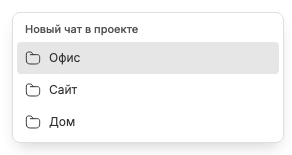

# Новый чат в недавно активном проекте

Непрокручиваемый плюс справа от вкладок открывает штатный composer BB и фокусирует prompt; серверный чат не создаётся до штатной отправки. Выбор проекта происходит в отдельном меню той же кнопки и лишь предвыбирает проект для composer.

Меню раскрывается через 300 мс mouse-hover или ArrowDown. Обычный клик по плюсу выполняет переход, а не открывает системный select. Touch не имитирует hover; остаётся штатный клик для нового чата.

Сначала показаны проекты с открытыми вкладками текущего режима, затем остальные недавно активные проекты. Внутри групп сохранён порядок последней неархивной активности чатов, включая дочерние; при равенстве — по имени. Проект открытой вкладки остаётся доступен и без его чатов в загруженном sidebar. Личный проект исключён. Это не отдельный ручной порядок режима и не перестановка левого sidebar BB. Первые 15 видны сразу; «Ещё» раскрывает следующие 15 на клик/tap или через 300 мс наведения. Это не полный каталог всех проектов BB и не создание workspace Chat Tabs.

При уходе мыши hover-меню закрывается, но переход с кнопки в popup сохраняет его. Оно учитывает границы viewport и анимации ОС. Связанные заметки: [экран чата](chat-screen.md), [Новый чат](new-chat-screen.md), [hover и фокус](hover-and-focus.md), [различие режима и окружения](limits-and-boundaries.md).
