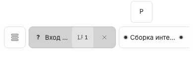
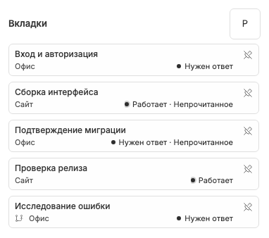

# Desktop/mobile, прокрутка и панели BB

Compact-представление включается при ширине до 767 px или coarse pointer; header дополнительно получает compact-флаг хоста. Поэтому небольшой размер экрана — не единственный признак touch-layout.

Desktop-полоса с переполнением преобразует обычное vertical wheel в горизонтальную прокрутку, включая над активным tab; `Ctrl/⌘+wheel` остаётся native zoom/gesture. Синхронизированный scrollbar находится над вкладками только при реальном overflow, без пустого rail и лишнего focus-target при полном размещении.

Touch использует native горизонтальный swipe без desktop proxy-scrollbar. Close/menu цели не меньше 44 px, домашние карточки становятся вертикальными. HTML drag-and-drop не рекламируется как поддерживаемый touch-жест перестановки. Header-selector показывает полный grapheme вместо длинного label.

Обычная правая панель ограничивает полосу шириной main chat и не считается split. При смене активного чата или доступной ширины полоса горизонтально прокручивается так, чтобы активная вкладка снова была видна: на desktop выбирается ближайшая позиция, на compact — начало вкладки с учётом touch scroll snap. Это работает и при появлении/скрытии правой панели, не переносит фокус и не прокручивает переписку. Ручная прокрутка к другим вкладкам не сбрасывается обычными обновлениями статусов. True split, full-screen right panel, sidebar drawer или mobile drawer скрывают overlay и его меню без пустого отступа. Header-action может монтироваться отдельно для видимых thread panes; выбранный режим при этом оконный.

В современных браузерах overlay использует CSS anchors, в старых — измерение публично доступной layout-области, объединённое в animation frame. Условия layout отражаются в одном атрибуте одним MutationObserver на документ, без глобальных `body:has(...)`: учитывается любой подходящий overlay, включая переходные mounts, а после последнего unmount наблюдение и атрибут удаляются. CSS сохраняет прежние приоритеты. Плагин не reparent-ит DOM или native right-panel tabs. Геометрию нужно проверять при обновлении BB; скриншоты 390 px не являются физическим iOS/Android-тестом.

Связанные заметки: [экран чата](chat-screen.md), [порядок](manual-tab-order.md), [настройки](plugin-settings.md), [доступность](theme-motion-accessibility.md).
