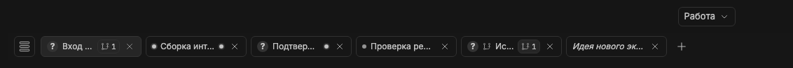

# Серый индикатор sidechat и вложенной работы

Если основной чат сам не работает, но у него активен sidechat, его вкладка показывает спокойную серую точку без halo. Она отличает работу связанного чата от прямой runtime-активности основного. То же muted-представление применяется к активности только вложенных потомков.

Скрытые sidechat связаны через `sourceThreadId` и `originPluginId: side-chat`; наличие `parentThreadId` не обязательно. Поэтому обычного дерева sidebar недостаточно. Сервер получает начальные metadata скрытых sidechat и отслеживает lifecycle/status events; текст сообщений не читается, sidechat не создаются и не запускаются плагином.

Одновременные sidechat учитываются по собственным ID: завершение одного не снимает сигнал другого. Обновления имеют отдельные generation/revision, чтобы старый seed, realtime или предыдущая загрузка плагина не откатывали актуальную активность. Работа источника передаётся и его доступным предкам.

Как только основному чату BB сообщает прямую работу, возвращается обычный индикатор. Pending interaction по-прежнему имеет приоритет «?»; unread остаётся независимым. Текстовый статус карточки называется «Работает», а не отдельной новой категорией.

Связанные заметки: [рабочие признаки](working-indicator.md), [ожидание](waiting-for-input.md), [синхронизация](synchronization-and-errors.md), [дерево детей](subthread-navigation.md).
