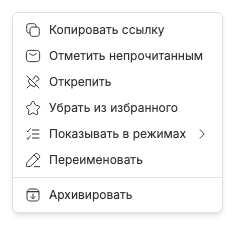

# Контекстное меню вкладки

Правый щелчок по закреплённой или preview-вкладке открывает меню её чата. Оно не является меню режима: часть действий изменяет локальное представление Chat Tabs, часть — сам чат BB.

- «Скопировать ссылку» копирует абсолютный URL без смены маршрута; [clipboard fallback](chat-link-copy.md) работает при отсутствии Clipboard API.
- «Пометить непрочитанным» меняет read-state BB, не останавливая runtime; [индикатор непрочитанности](unread-indicator.md) независим от работы.
- «Закрепить» или «Открепить» меняет pin только в текущем режиме; [открепление](pinned-tabs.md) делает чат единственной preview.
- «Добавить в избранное» или «Убрать из избранного» меняет отдельный список, не pin; [избранное](favorite-chats.md) переживает закрытие вкладки.
- «Цвет вкладки» выбирает один из шести цветов палитры либо «Как у проекта»; оформление общее для режимов и не меняет название чата. Палитра и алиасы редактируются в `docs/plugin-settings.md`.
- «Показывать в режимах» открывает [независимые memberships](workspace-memberships.md); пункт скрыт при выключенных режимах.
- «Переименовать» открывает [диалог названия чата](chat-renaming.md), изменяющий также sidebar BB.
- «Архивировать» запускает рекурсивное действие BB, а не обычное закрытие; [потомки и lifecycle](archive-delete-lifecycle.md) обрабатываются отдельно.

Постоянной pin-кнопки в полосе нет. Удаление чата не предлагается этим меню. Escape закрывает popup; keyboard/touch-поведение следует доступным Radix-меню, а не desktop hover как обязательному способу доступа.
