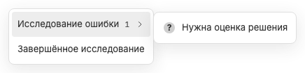

# Ожидание ответа или подтверждения

Когда BB сообщает pending interaction или `waiting-for-input`, вкладка показывает «?» вместо рабочей точки. Это может быть вопрос пользователю или approval действия; неизвестный вид interaction не выдаётся за конкретный вопрос.

Ожидание передаётся доступным родителям: родительская вкладка сигнализирует о блокировке потомка, даже если сама спокойна. Tooltip и accessible name уточняют ожидание; в меню и домашних карточках статус называется «Нужен ответ».

Ожидание сильнее рабочего сигнала, чтобы пользователь не принимал блокировку за продолжающееся вычисление. Однако отдельная [точка unread](unread-indicator.md) не исчезает; карточка может показать «Нужен ответ · Непрочитанное».

Снятие pending interaction убирает «?»; фоновые события не открывают preview и не переводят пользователя к заблокированному чату автоматически. Выбор выполняется через обычную навигацию или [дерево детей](subthread-navigation.md).

Плагин только отображает состояние BB, не отвечает за пользователя и не подтверждает permissions. Связанные заметки: [рабочая активность](working-indicator.md), [sidechat](sidechat-activity.md), [экран чата](chat-screen.md).
