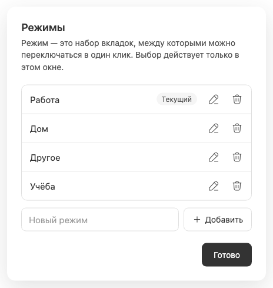

# Создание режима без смены чата

Новый режим создаётся из отдельного поля в [управлении режимами](workspace-management.md). Его вкладки и избранное пусты; он не наследует содержимое текущего набора. Изначально существуют «Работа», «Дом», «Другое»; допустимы от 1 до 20 режимов.

После успешного создания новый режим появляется в каталоге всех окон, но ни одно окно не переключается на него автоматически. Текущий чат, маршрут и выбранный набор сохраняются; окно управления не закрывается. Поле добавления очищается, новую строку можно сразу переименовать или добавить следующую.

Имя содержит 1–80 Unicode code points после удаления крайних пробелов. Дубликаты без учёта регистра запрещены, включая переведённые имена существующих системных режимов. У front-end и server одинаковая валидация; ошибка не очищает введённый текст. При 20 наборах поле и добавление недоступны.

Даже если другое окно обновило каталог или пользователь сменил выбор до ответа RPC, создание только принимает metadata и не восстанавливает старую навигацию. Переход в пустой набор происходит лишь при [явном переключении](workspace-switching.md); это открывает composer, а не создаёт чат на сервере. См. [переименование](workspace-renaming.md) и [синхронизацию](synchronization-and-errors.md).
