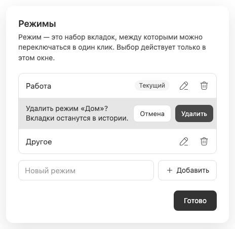

# Удаление режима с подтверждением

Корзина в [управлении режимами](workspace-management.md) сначала раскрывает подтверждение внутри выбранной строки. Пока пользователь не подтвердил действие, режим и его содержимое не меняются; отмена возвращает строку и сохраняет черновик добавления.

Удаляется только набор: его вкладки, избранное и локальные сведения выбора/undo для исчезнувшего ID. Сами чаты, их агенты, история BB и общая история переходов Chat Tabs не удаляются и не архивируются. Последний оставшийся режим удалить нельзя; это защищено не только disabled-кнопкой, но и серверной валидацией.

Удаление невыбранного режима не навигирует. Если выбранный режим исчез, окно выбирает первый оставшийся; исходное действие может восстановить его активный чат, только пока пользователь не сформировал более новое намерение навигации. Другие окна меняют выбор лишь при удалении выбранного ими ID; late replies не могут отменить новый маршрут.

Удаление набора не является [архивацией чата](archive-delete-lifecycle.md), не попадает в [стек закрытых вкладок](closed-tab-restoration.md) и не отменяется созданием режима с тем же названием: новый ID будет другим. Связанные заметки: [выбор окна](window-local-selection.md), [переключение](workspace-switching.md), [ошибки и ревизии](synchronization-and-errors.md).
