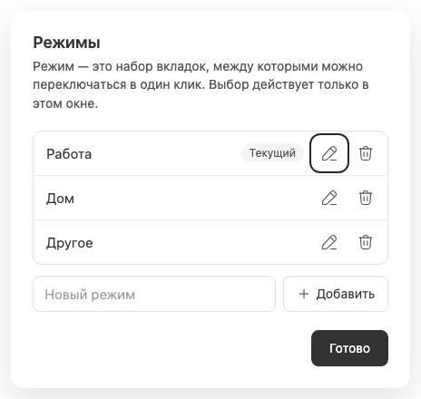
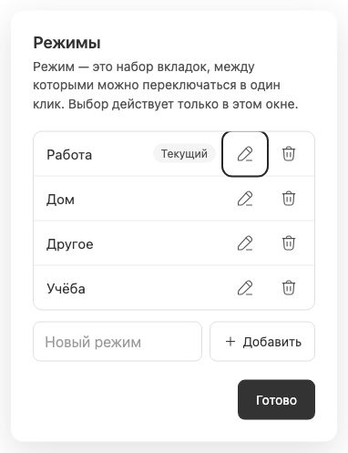

# Окно управления режимами

Окно открывается последним пунктом [переключателя](workspace-selector.md). Оно управляет каталогом режимов, а не активностью чатов или окружениями BB. Само открытие не меняет выбор окна и маршрут.

Каждая строка содержит имя, badge «Текущий» для выбранного набора, кнопку переименования и корзину. [Inline rename](workspace-renaming.md) и [подтверждение удаления](workspace-deletion.md) заменяют только свою строку. Отдельное поле добавления сохраняет черновик при отмене этих действий; переключение между rename/delete не должно его очищать.

[Создание](workspace-creation.md) очищает только успешно сохранённое поле добавления и оставляет окно открытым. Кнопка «Готово» и Escape закрывают окно с возвратом фокуса к trigger. Во время RPC закрытие и повторные действия блокируются; ошибка остаётся внутри окна, не выдавая неуспешную операцию за сохранённую.

Последний режим защищён от удаления, каталог ограничен 20 записями. Длинный список прокручивается; длинные имена имеют tooltip. На mobile controls не меньше 44 px, подтверждение переносится на отдельную строку. Открытие/закрытие и backdrop анимированы с учётом [reduced motion](theme-motion-accessibility.md).

