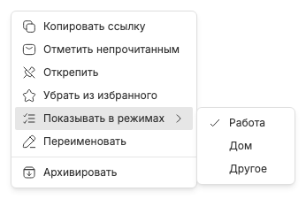

# Один чат в нескольких режимах

Подменю «Показывать в режимах» в [контекстном меню вкладки](tab-context-menu.md) редактирует присутствие чата в наборах независимо от выбора текущего окна. Галочка означает вкладку в `state.entries`, а не запись избранного.

Включение добавляет закреплённую вкладку в адресованный режим. Снятие закрывает только вкладку этого режима и устанавливает защиту от автоматического reopening. Избранное не удаляется; содержимое других наборов не меняется. Можно отметить несколько наборов, не закрывая меню.

Даже снятие галочки с текущего режима не меняет маршрут: чат может остаться открытым в BB без вкладки Chat Tabs. Операция не попадает в [стек явных закрытий](closed-tab-restoration.md). При выключенных режимах submenu скрыто, но memberships сохраняются.

Каталог и memberships загружаются только при открытии submenu и освежаются по realtime/reconnect, без постоянного polling. Во время записи пункты отключены. Ошибка оставляет прежнюю галочку и кнопку Retry; старые ревизии, late replies и ответы закрытого submenu отбрасываются.

Связанные заметки: [избранное](favorite-chats.md), [закрытие](tab-closing.md), [выключение режимов](workspaces-disabled.md), [синхронизация](synchronization-and-errors.md).
