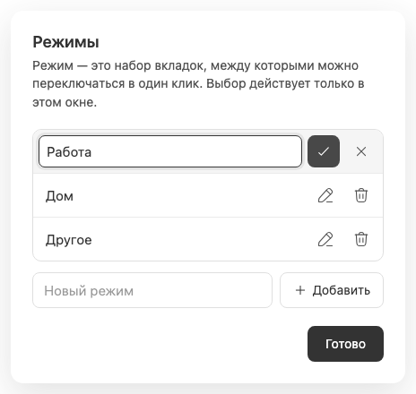

# Переименование режима

Кнопка карандаша в [управлении](workspace-management.md) превращает строку режима в inline-форму с полем, сохранением и отменой. Другие строки и отдельный черновик добавления остаются доступными вне pending RPC.

Переименование сохраняет стабильный ID: вкладки, избранное, порядок, window selection и last-active не пересоздаются. Новый текст виден всем окнам через каталог; маршрут и выбранный чат не меняются. Допустимо 1–80 Unicode code points после trim, с той же проверкой дублей, что у [создания](workspace-creation.md).

Отмена возвращает обычную строку без RPC и не теряет новый режим, набранный в отдельном поле. Ошибка сохранения остаётся в диалоге; успешное сохранение завершает редактор. Во время pending повторные действия отключены.

Особенность системных имён: «Работа», «Дом», «Другое» показываются на текущем языке плагина, пока не переименованы. Сохранённое пользовательское имя прекращает автоматический перевод, даже если визуально совпадает с прежним системным названием. Подробнее: [язык интерфейса](interface-language.md). Это metadata режима, а не [переименование самого чата](chat-renaming.md).
