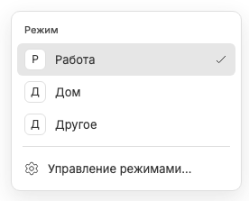

# Переключение режима восстанавливает активный чат

Явный выбор режима из selector меняет оконный набор и открывает его последнюю активную вкладку в этом окне. Если она больше не входит в свежий набор, открывается первая сохранённая вкладка; для пустого набора — штатный Новый чат с фокусом prompt, без создания чата на сервере.

Last-active хранится отдельно для каждого режима. Запоминаются только реально просматриваемые вкладки набора, не оставленный маршрут предыдущего режима. Уже открытый целевой чат не навигируется повторно; pins, preview и favorites режима не подменяются вкладкой, откуда пользователь ушёл.

После выбора новое посещение сбрасывает прежние pending, ошибки и домашние undo-карточки. Снимок запрашивается с workspace ID; поколения выбора, route epoch, URL и ревизии исключают запоздавшую навигацию после A→B→A, нового перехода или изменённого выбора. Старый снимок может получить один retry, но не бесконечно отменять намерение пользователя.

Получение каталога, переименование или создание режима не является явным переключением. Создание оставляет текущий чат и управление открытыми. При удалении выбранного набора возможен защищённый fallback; при выключении режимов восстановление выбора не выполняет навигацию.

Связанные заметки: [selector](workspace-selector.md), [выбор окна](window-local-selection.md), [создание](workspace-creation.md), [выключение режимов](workspaces-disabled.md).
